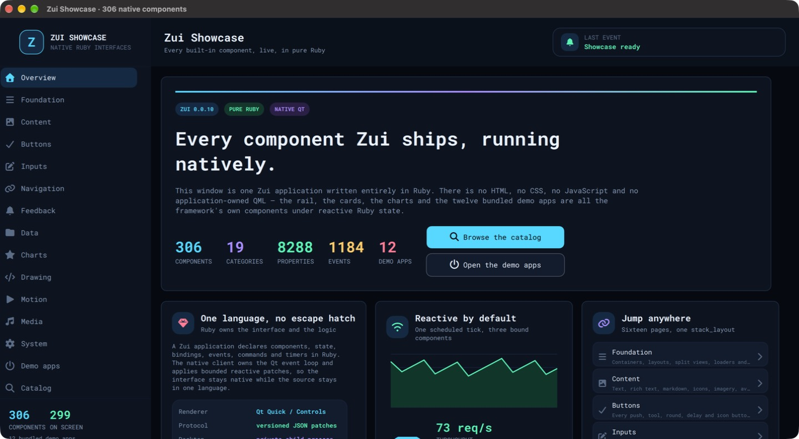

<h1 align="center">showcase-zui</h1>

<p align="center">
  <strong>Every component the Zui framework ships, running natively, in one pure-Ruby application.</strong>
</p>

<p align="center">
  
  
  
  
  
</p>

---

`showcase-zui` is a single [Zui](https://github.com/AdamMusa/zui) application whose only job is to
show what the framework can do. Seventeen pages, one per component category, a live catalog read
straight out of the framework's own registry, and twelve complete demo applications you can launch
from inside it.

Every pixel in it is a native Qt control driven from Ruby. There is no HTML, no CSS, no JavaScript,
no WebView and no application-owned QML anywhere in this repository.

<p align="center">
  
</p>

<p align="center"><sub>The showcase's own home page, captured from the running application.</sub></p>

## Why Zui

**Ruby, all the way down.** You declare components, state, bindings, events, commands and timers in
Ruby. There is no template language to learn, no second file format to keep in sync and no bridge
layer to debug — the program you read is the program that runs.

```ruby
Zui::Application.new(ui: UI) do
  state :pulse, [12, 24, 38]

  app :main, title: "Showcase", width: 1440, height: 780 do
    chart = line_chart state.pulse, color: "#5df2b4"
    bind(chart, :values) { state.pulse }
  end

  every(1.0) { state.pulse = state.pulse.drop(1) + [rand(20..90)] }
end
```

**Genuinely native.** Qt Quick draws the interface: real menus, real dialogs, real file pickers,
GPU shaders and particles, hardware-accelerated animations on the render thread. It looks and feels
like a desktop application because it is one.

**Reactive without a framework tax.** Write to state and the bindings that read it update — only
those. Zui tracks which state each binding touched, so a one-field change patches one property
instead of rebuilding a tree.

**306 components in the box.** Layouts, inputs, charts, tables, trees, media, sensors, maps,
shaders, dialogs and the sixteen chart types are all built in. This showcase renders essentially
every one of them, so what you see here is what you get without writing a widget.

**One source tree, five platforms.** The same Ruby runs on Linux, macOS and Windows as a desktop
application, and on iOS and Android through an embedded mruby runtime. `zui bundle --dist` produces
a native installer for the platform you are on.

**Nothing to serve.** No browser engine, no node process, no dev server. The application is a Ruby
program and a private native client, and it starts like one.

## Quick start

```bash
gem install zui
zui doctor --fix        # downloads and verifies the native client, once
```

```bash
zui run main.rb
```

To launch one of the bundled applications directly:

```bash
zui run demos/smart_home_energy/main.rb
```

The showcase renders the **complete** catalog, so it prefers a local Zui checkout as a sibling
directory (`../zui`) and falls back to the published gem. Point it somewhere else with `ZUI_PATH`:

```bash
ZUI_PATH=/path/to/zui zui run main.rb
```

## What is inside

| Page | What it shows |
| --- | --- |
| **Overview** | Hero, live telemetry, coverage counters, quick jump to every page |
| **Foundation** | Containers, rows, columns, grids, Qt layouts, flow, split views, stacks, scroll, flickable, loader, flipable |
| **Content** | Text, labels, rich text, markdown, every named icon, images, vectors, animated images, avatars, badges, chips |
| **Buttons** | Push, round, tool, delay, icon and bar buttons, toggles, checkboxes, radios, button groups, actions |
| **Inputs** | Fields, areas, passwords, search, spin boxes, sliders, dials, dropdowns, multi-select, native pickers |
| **Navigation** | Tabs, tab bars, rails, breadcrumbs, pagination, expansion panels, accordions, stack and swipe views, drawer |
| **Feedback** | Menu bars, menus, context menus, dialogs, sheets, popups, snackbars, banners, toasts, progress, skeletons |
| **Data** | Lists, grids, tables, data tables, trees, every delegate, reorderable lists, carousels, calendars, headers |
| **Charts** | All sixteen chart and gauge components, several bound to a live scheduler |
| **Drawing** | Canvas, shapes, paths, gradients, compiled shaders, particles, drag, drop, pinch, hover, tap, wheel |
| **Motion** | Imperative and declarative animations, animators, groups, springs, states, transitions, timers |
| **Effects** | Blur, colorize, glow, multi-effect, drop and rectangular shadows, opacity masks over real pixels |
| **Media** | Media player with real transport, audio, sound effects, device enumeration, camera, capture, recording |
| **System** | Models, proxies, system info, network, paths, settings, clipboard, permissions, sensors, maps, web, speech |
| **Demo apps** | Twelve bundled applications, each launchable as its own native process |
| **Catalog** | The live registry: filter 306 components and inspect any component's full contract |
| **About** | How it is built, how to run it, and the palette it is themed with |

## The bundled applications

Each one is a complete Zui application with its own `main.rb`, assets and README.

| Demo | What it is |
| --- | --- |
| [Habitat One](demos/smart_home_energy) | Smart-home energy twin with a reactive, image-backed living room |
| [Tesla Drive Lab](demos/tesla_drive_dashboard) | EV centre display with a canvas map, climate controls and local audio |
| [Nebula Command](demos/futuristic_dashboard) | Orbital operations dashboard with particles, charts and GPU effects |
| [Pulse Atlas](demos/cardiac_health_monitor) | Cardiac visualization with ECG charting, gauges and a recovery heatmap |
| [Stratos](demos/orbital_weather_console) | Weather console whose layers drive real GPU brightness and colorization |
| [Quantum Market](demos/quantum_market_terminal) | Paper-trading terminal with candlesticks and simulated fills |
| [Nocturne](demos/cinematic_music_studio) | Spatial music studio with a real Qt Multimedia transport |
| [Nova Pour](demos/nova_pour) | Restaurant drink ordering with a reactive cart and bar telemetry |
| [Lumen Forge](demos/lumen_forge) | Live GPU shader laboratory with reactive uniforms |
| [Avatar Runner](demos/avatar_runner) | Native endless runner with canvas physics and keyboard focus |
| [Mobile Kitchen Sink](demos/mobile_kitchen_sink) | Mobile runtime acceptance app: permissions, sensors, capture, maps |
| [Mobile Counter](demos/mobile_counter) | Touch-first sample for the embedded mruby mobile runtime |

Launching from the showcase runs `zui run demos/<app>/main.rb` as a detached child process from the
repository root. If it fails — `zui` not on `PATH`, native client not installed — the reason is
shown on the card. Set `ZUI_COMMAND` to override the executable.

> Nova Pour and Lumen Forge are the refined versions of the upstream `restaurant_drinks` and
> `shader_studio` examples. Those two are byte-identical to the refined ones, so only the refined
> versions are bundled here.

## Repository layout

```text
main.rb                     entry point
app.rb                      state declarations and the application window
showcase/
├── theme.rb                colour and metric tokens
├── nav.rb                  the page list that drives the rail and the stack
├── assets.rb               media borrowed from the bundled demos
├── demos.rb                demo catalog and metadata
├── catalog_data.rb         generated category map (script/generate_catalog.rb)
├── support.rb              card, panel and typography helpers
├── chrome.rb               sidebar, top bar and the page stack
├── catalog.rb              registry-driven catalog and schema inspector
└── pages/                  one file per category page
assets/                     the two files this showcase adds (Lottie, PDF)
demos/                      twelve standalone Zui applications
script/
├── verify.rb               builds the whole tree and validates it
└── generate_catalog.rb     regenerates showcase/catalog_data.rb from a Zui checkout
```

## Verifying without a display

Zui validates every component, property, event and binding while the application is being built, so
building the tree is a real check — no window required.

```bash
ruby script/verify.rb
```

```text
surfaces          main
nodes             4341
component types   299 of 306 registered
pages             17
demo apps         12

OK — the showcase builds clean
```

## Packaging

```bash
zui bundle            # standalone, embedded mruby
zui bundle --full     # private CRuby and the locked gems
zui bundle --dist     # native installer for the current platform
```

## Licence

MIT — see [LICENSE](LICENSE). Zui itself is MIT.

The imagery, audio and shaders on the Content, Media, Motion and Drawing pages are the assets that
ship with the bundled demo applications; each demo keeps its own README and provenance notes.
`assets/showcase-spin.json` and `assets/showcase-note.pdf` were written for this repository.
