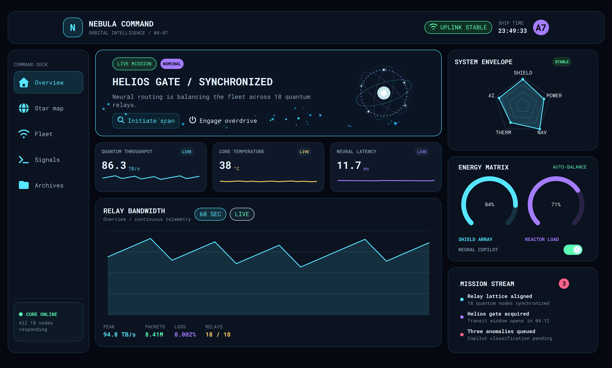

<h1 align="center">showcase-zui</h1>

<p align="center">
  <strong>Every component the Zui framework ships, running natively, in one pure-Ruby application.</strong>
</p>

<p align="center">
  
  
  
  
  
</p>

---

`showcase-zui` is a single [Zui](https://github.com/AdamMusa/zui) application whose only job is to
show what the framework can do. Sixteen pages, one per component category, plus a live catalog read
straight out of the framework's own registry — and twelve complete demo applications you can launch
from inside it.

There is no HTML, CSS, JavaScript, WebView or application-owned QML anywhere in this repository. The
rail, the cards, the charts, the shaders and the dialogs are all framework components under reactive
Ruby state.

<p align="center">
  
</p>

<p align="center"><sub>Nebula Command — one of the twelve bundled demo apps, launchable from the showcase's Demo apps page.</sub></p>

## Quick start

```bash
gem install zui
zui doctor --fix        # downloads and verifies the native client, once
```

```bash
zui run main.rb
```

To launch one of the bundled applications directly:

```bash
zui run demos/smart_home_energy/main.rb
```

The showcase renders the **complete** catalog, so it prefers a local Zui checkout as a sibling
directory (`../zui`) and falls back to the published gem. Point it somewhere else with `ZUI_PATH`:

```bash
ZUI_PATH=/path/to/zui zui run main.rb
```

## What is inside

| Page | What it shows |
| --- | --- |
| **Overview** | Hero, live telemetry, coverage counters, quick jump to every page |
| **Foundation** | Containers, rows, columns, grids, Qt layouts, flow, split views, stacks, scroll, flickable, loader, flipable |
| **Content** | Text, labels, rich text, markdown, every named icon, images, vectors, animated images, avatars, badges, chips |
| **Buttons** | Push, round, tool, delay, icon and bar buttons, toggles, checkboxes, radios, button groups, actions |
| **Inputs** | Fields, areas, passwords, search, spin boxes, sliders, dials, dropdowns, multi-select, native pickers |
| **Navigation** | Tabs, tab bars, rails, breadcrumbs, pagination, expansion panels, accordions, stack and swipe views, drawer |
| **Feedback** | Menu bars, menus, context menus, dialogs, sheets, popups, snackbars, banners, toasts, progress, skeletons |
| **Data** | Lists, grids, tables, data tables, trees, every delegate, reorderable lists, carousels, calendars, headers |
| **Charts** | All sixteen chart and gauge components, several bound to a live scheduler |
| **Drawing** | Canvas, shapes, paths, gradients, compiled shaders, particles, drag, drop, pinch, hover, tap, wheel |
| **Motion** | Imperative and declarative animations, animators, groups, springs, states, transitions, timers, GPU effects |
| **Media** | Media player with real transport, audio, sound effects, device enumeration, camera, capture, recording |
| **System** | Models, proxies, system info, network, paths, settings, clipboard, permissions, sensors, maps, web, speech |
| **Demo apps** | Twelve bundled applications, each launchable as its own native process |
| **Catalog** | The live registry: filter 306 components and inspect any component's full contract |
| **About** | How it is built, how to run it, the palette, and an honest coverage breakdown |

## Honest coverage

The catalog page and the coverage counters are **not** maintained by hand. On startup the showcase
reads the framework registry (`Zui::DEFAULT_COMPONENTS.protocol_schema`) and then walks its own
finished node tree, so the "on screen" column in the catalog is counted from what really rendered.

At the time of writing that is **299 of 306** components rendered live. The seven that are not are
named and explained on their own category pages:

| Component | Why it is catalogued only |
| --- | --- |
| `application_window`, `window` | Surface-level: `app :main` declares one per surface, above the page |
| `responsive_view` | Sizes itself to the whole window; the mobile demos use it as a root |
| `key_catcher` | Window-level key routing; Avatar Runner demonstrates it |
| `video` | Needs a video file this repository does not ship |
| `model_view_3d` | Needs a 3D asset and the Qt Quick 3D module |
| `font_loader` | Needs a font file to register at runtime |

Components that need an optional Qt module — maps, the web view, the Lottie animation and the PDF
view — are declared behind a `loader` with a switch, so a host without `QtLocation`, `QtWebView`,
Lottie or `QtPdf` still runs the whole showcase and reports the failure in the activity strip
instead of pretending.

## The bundled applications

Each one is a complete Zui application with its own `main.rb`, assets and README.

| Demo | What it is |
| --- | --- |
| [Habitat One](demos/smart_home_energy) | Smart-home energy twin with a reactive, image-backed living room |
| [Tesla Drive Lab](demos/tesla_drive_dashboard) | EV centre display with a canvas map, climate controls and local audio |
| [Nebula Command](demos/futuristic_dashboard) | Orbital operations dashboard with particles, charts and GPU effects |
| [Pulse Atlas](demos/cardiac_health_monitor) | Cardiac visualization with ECG charting, gauges and a recovery heatmap |
| [Stratos](demos/orbital_weather_console) | Weather console whose layers drive real GPU brightness and colorization |
| [Quantum Market](demos/quantum_market_terminal) | Paper-trading terminal with candlesticks and simulated fills |
| [Nocturne](demos/cinematic_music_studio) | Spatial music studio with a real Qt Multimedia transport |
| [Nova Pour](demos/nova_pour) | Restaurant drink ordering with a reactive cart and bar telemetry |
| [Lumen Forge](demos/lumen_forge) | Live GPU shader laboratory with reactive uniforms |
| [Avatar Runner](demos/avatar_runner) | Native endless runner with canvas physics and keyboard focus |
| [Mobile Kitchen Sink](demos/mobile_kitchen_sink) | Mobile runtime acceptance app: permissions, sensors, capture, maps |
| [Mobile Counter](demos/mobile_counter) | Touch-first sample for the embedded mruby mobile runtime |

Launching from the showcase runs `zui run demos/<app>/main.rb` as a detached child process from the
repository root. If it fails — `zui` not on `PATH`, native client not installed — the reason is
shown on the card. Set `ZUI_COMMAND` to override the executable.

> Nova Pour and Lumen Forge are the refined versions of the upstream `restaurant_drinks` and
> `shader_studio` examples. Those two are byte-identical to the refined ones, so only the refined
> versions are bundled here.

## Repository layout

```text
main.rb                     entry point
app.rb                      state declarations and the application window
showcase/
├── theme.rb                colour and metric tokens
├── nav.rb                  the page list that drives the rail and the stack
├── assets.rb               media borrowed from the bundled demos
├── demos.rb                demo catalog and metadata
├── catalog_data.rb         generated category map (script/generate_catalog.rb)
├── support.rb              card, panel and typography helpers
├── chrome.rb               sidebar, top bar and the page stack
├── catalog.rb              registry-driven catalog and schema inspector
└── pages/                  one file per category page
assets/                     the two files this showcase adds (Lottie, PDF)
demos/                      twelve standalone Zui applications
script/
├── verify.rb               builds the whole tree and validates it
└── generate_catalog.rb     regenerates showcase/catalog_data.rb from a Zui checkout
```

## Verifying without a display

Zui validates every component, property, event and binding while the application is being built, so
building the tree is a real check. `script/verify.rb` does exactly that and prints what it produced:

```bash
ruby -I../zui/lib script/verify.rb
```

```text
surfaces          main
nodes             4051
component types   299 of 306 registered
pages             16
demo apps         12

OK — the showcase builds clean
```

It fails if a page is missing, a node id collides, an unknown component type appears, a demo's
`main.rb` is missing or a referenced asset is not in the checkout.

## Packaging

```bash
zui bundle            # standalone, embedded mruby
zui bundle --full     # private CRuby and the locked gems
zui bundle --dist     # native installer for the current platform
```

## Licence

MIT — see [LICENSE](LICENSE). Zui itself is MIT.

The imagery, audio and shaders on the Content, Media, Motion and Drawing pages are the assets that
ship with the bundled demo applications; each demo keeps its own README and provenance notes.
`assets/showcase-spin.json` and `assets/showcase-note.pdf` were written for this repository.
